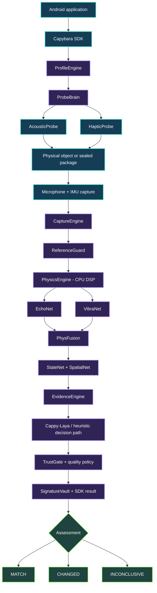

<div align="center">


# 🦫 CAPYBARA

### Give the physical world a memory.

**A camera-free, fully offline Android SDK for non-invasive physical integrity checks.**

Detect meaningful changes in sealed packages using **sound, vibration, on-device signal processing, and adaptive AI** — without opening the box.

<p>
  <a href="https://github.com/ChristopherJoshy/Capybara"></a>
  <a href="LICENSE"></a>
  
  
</p>

<p>
  
  
  
  
  
</p>

**[Explore the idea](#-the-problem)** · **[See how it works](#-how-capybara-works)** · **[Architecture](#-under-the-hood)** · **[Benchmarks](#-results--testing)** · **[Get started](#-quick-start)** · **[Research](#-research-that-inspired-capybara)**

</div>

---

## 📦 The problem

### The package looks right. What about what's inside?

A parcel can arrive with an intact seal and still contain the wrong product, missing accessories, substituted goods, or a changed internal arrangement. At each handover — seller to courier, courier to customer, customer to return center — somebody has to decide whether the contents are still consistent with the original package.

The usual methods have blind spots:

| Existing approach | What it tells you | What it cannot reliably tell you |
|:--|:--|:--|
| 📦 Open the package | Visible contents and visible damage | Breaks the closed-package workflow; adds handling, time, and risk of accidental damage |
| ⚖️ Weigh it | Total mass | Same-mass substitutions or meaningful changes without a large weight difference |
| 🏷️ Check the seal | Whether a particular seal shows interference | Whether the internal contents still match a trusted reference |
| 📷 Photograph the outside | External appearance | What changed inside opaque packaging |
| 🏭 Specialized inspection equipment | More detailed information for supported applications | Requires additional hardware, cost, training, or operating constraints |

**Capybara adds a different kind of evidence:** a repeatable **physical-response comparison** while the package remains closed.

> **The key idea:** You do not always need to see inside an object to notice that its physical response has changed.

---

## ✨ Meet Capybara

Capybara is an **open-source Android SDK** that lets developers build physical integrity checks directly into their own apps. It uses a phone's available speaker, vibration actuator, microphone, accelerometer, and gyroscope to excite and observe a contacted package or object.

A trusted baseline is recorded first. When the same object is checked again, Capybara compares the new response with the reference and evaluates the difference using signal processing, multimodal evidence, and its decision engine.

<div align="center">


**`ENROLL` → `RE-SCAN` → `ANALYZE` → `MATCH / CHANGED / INCONCLUSIVE`**

</div>

### Why this is different

<table>
<tr><td width="50%" valign="top">

**🔒 Private by design**

Audio capture, sensor processing, evidence generation and inference run locally. No remote decision service or account is required to scan.

</td><td width="50%" valign="top">

**📵 Camera-free operation**

Uses physical responses rather than photos. No camera permissions, image recognition, or line of sight through the package.

</td></tr>
<tr><td valign="top">

**🧠 Adaptive decision paths**

Use Cappy-Laya on devices selected by the configurable resource policy or the lightweight heuristic engine on constrained phones.

</td><td valign="top">

**🧩 SDK, not a locked-down app**

Build your own interface, container profiles, verification rules, and follow-up actions. Apache-2.0 licensing enables commercial use.

</td></tr>
<tr><td valign="top">

**📳 Multimodal sensing**

Combines acoustic and inertial evidence to analyze how an object responds to controlled excitation.

</td><td valign="top">

**🛡️ Evidence-first decisions**

Uses saved baselines, capture provenance, quality checks and an explicit inconclusive outcome when a scan cannot support a reliable conclusion.

</td></tr>
</table>

---

## 🔬 How Capybara works

### 1. Create a trusted physical reference

Choose a supported container or object, place the phone according to the selected scanning profile, and collect the reference measurements. Capybara captures the response, associates it with the scan positions, and saves a protected research/reference record for comparison.

### 2. Excite the object

A controlled acoustic probe and, when available, a haptic probe stimulate the physical system. The actual response depends on the object's packaging, contents, geometry, materials, contact, and device hardware.

### 3. Listen and feel

The microphone records sound while available inertial sensors record motion. Timing, device routes, sample counts, and measurement metadata are retained as evidence rather than discarded.

### 4. Extract physical features

On-device DSP analyzes properties such as signal energy, spectral distribution, motion, repeatability, and changes relative to the trusted baseline. Multiple available sensor channels provide complementary measurements.

### 5. Make a decision — or abstain

The appropriate processing path evaluates the collected evidence. The application receives a structured outcome for its workflow:

| Outcome | Interpretation | Recommended application action |
|:--:|:--|:--|
| 🟢 **MATCH** | The response is sufficiently consistent with the selected reference under the configured decision policy | Continue the normal workflow |
| 🟠 **CHANGED** | The response indicates a meaningful difference under the configured decision policy | Request inspection, rescan, or review |
| ⚪ **INCONCLUSIVE** | Data quality, support conditions, or confidence do not justify a definite decision | Reposition, rescan, or use another inspection method |

**Capybara detects changes in measured physical response. It is not an X-ray scanner, and a MATCH does not guarantee that an item is authentic, safe, or undamaged.**

---

## 🌈 One phone. Multiple sensing modalities.

<div align="center">


</div>

| Layer | Inputs | Role |
|:--|:--|:--|
| 🔊 **AcousticProbe** | Speaker output + microphone capture | Stimulates and records the object's acoustic response |
| 📳 **HapticProbe** | Available vibration motor(s) + IMU | Observes vibration-coupled behavior |
| 📈 **PhysicsEngine** | Actual PCM and IMU measurements | Computes interpretable signal descriptors and differences |
| 🧬 **EchoNet / VibraNet** | Acoustic and motion evidence | Modality-specific learned analysis |
| 🔀 **PhysFusion** | Multiple model and physical features | Combines complementary evidence |
| 🧠 **StateNet / SpatialNet** | Changes across states and positions | Adds temporal and placement-aware interpretation |
| ⚡ **Cappy-Laya** | Structured, versioned evidence | Produces the AI-assisted decision output |
| 🛡️ **TrustGate** | Evidence, quality, policy, calibration | Controls when a verdict can be returned |

Because the SDK detects available hardware and follows configurable sensing profiles, an application can choose appropriate methods for different Android devices and package types. **Contact, orientation, materials, background noise, and size still affect measurements**, so repeatable placement and quality gates matter.

---

## 🧠 Smart execution: Cappy-Laya + lightweight fallback

<div align="center">


</div>

The same SDK can serve both high-resource phones and devices with limited RAM. **Developers control the decision policy** — the following describes the team's reported default configuration.

```text
                         DEVICE CHECK
                              │
                 RAM > 4 GB AND free space > 20 GB?
                        ┌─────┴─────┐
                        │           │
                       YES          NO
                        │           │
                 ┌──────▼──────┐ ┌──▼─────────────────┐
                 │ CAPPY-LAYA  │ │ LIGHTWEIGHT ENGINE │
                 │ AI DECISION │ │ HEURISTIC RULES    │
                 └─────────────┘ └────────────────────┘
                        │           │
                        └─────┬─────┘
                              ▼
                     INTEGRITY OUTCOME
```

| Resource / behavior | Cappy-Laya path | Heuristic path |
|:--|:--|:--|
| Intended device class | Higher-resource phones | Low-memory / constrained phones |
| Decision strategy | On-device AI-assisted analysis | Compact feature-based rules |
| Approx. application size* | **638 MB** | **54 MB** |
| Approx. memory use* | **800 MB** | **Under 50 MB** |
| Reported accuracy* | See overall test result below | **~85%** on team's fallback tests |
| Cloud requirement | None | None |
| Dedicated phone GPU requirement | None | None |

*Team-reported implementation figures; actual installed size, memory use, and accuracy vary with build, device and evaluation setup. The **20 GB** free-space check is a **configurable policy threshold**, not the size of the Laya model.*

**Compatibility philosophy:** CPU-first execution supports the Android ecosystem across Snapdragon, MediaTek and other compatible devices. Exact sensor capabilities still vary by model; apps should check them at runtime.

---

## 🏗️ Under the hood

<details open>
<summary><b>🧬 Expand / collapse the complete processing architecture</b></summary>



</details>

### Component map

| Component | Responsibility |
|:--|:--|
| **ProfileEngine** | Defines supported measurement procedures, registered positions and profile constraints |
| **ProbeBrain** | Selects acoustic and haptic excitation requests for a scan |
| **CaptureEngine** | Collects microphone and IMU streams with timing, routes, sample counts and cancellation handling |
| **ReferenceGuard** | Handles reference consistency and measurement-comparison safeguards |
| **PhysicsEngine** | Runs on-device spectral, energy, motion and quality analysis |
| **EchoNet / VibraNet** | Interpret acoustic and vibration information |
| **PhysFusion** | Combines sensor and model-level evidence |
| **StateNet / SpatialNet** | Account for differences across states and scan positions |
| **EvidenceEngine** | Structures reference/current comparisons for downstream decision logic |
| **Cappy-Laya** | Task-specific AI decision stage |
| **TrustGate** | Applies confidence, data-quality and abstention rules |
| **SignatureVault** | Stores trusted references with Android Keystore-backed protection and provenance |
| **Public SDK API** | Exposes capture, enrollment, comparison and assessment to the host application |

### Security and privacy choices

- **No internet permission required for the runtime.** Scans are processed on the device.
- **No camera dependency.** The package's appearance is not the sensor input.
- **Protected references.** Baseline storage uses Android Keystore / AES-GCM mechanisms.
- **Capture provenance.** Stored recordings and metadata can be checked against hashes to identify alteration of saved measurement records.
- **Fail-safe outcomes.** Uncertain observations can return `INCONCLUSIVE` instead of manufacturing a positive result.
- **Developer-owned workflow.** The SDK returns evidence; the host application decides whether to approve, log, rescan or escalate.

A capture hash establishes the provenance of recorded bytes. **It does not establish the physical identity of the object.**

---

## 📊 Results & testing

<div align="center">

| **~91%** | **170** | **~85%** | **15 kg** |
|:--:|:--:|:--:|:--:|
| Team-reported prototype accuracy | Products in reported test | Team-reported heuristic fallback accuracy | Maximum container weight tested |

</div>

The team reported an overall result of **approximately 91% across testing involving 170 products** and **approximately 85% with the lightweight heuristic path**. These figures describe the team's own test conditions; they are **not third-party certifications or universal guarantees**. They should not be compared with other benchmarks unless the object mix, test protocol, thresholds, and evaluation splits are aligned.

### Known physical considerations

| Factor | Why it matters |
|:--|:--|
| **Large / heavy containers** | The team reported reduced reliability with larger containers; the maximum tested weight was approximately 15 kg |
| **Materials and geometry** | Cardboard, plastic, metal, internal cushioning, and package shape change the measured response |
| **Device-specific hardware** | Speaker, microphone, motor and inertial characteristics differ across Android models |
| **Contact and placement** | Different positions and coupling can alter acoustic and vibration measurements |
| **Environment** | Ambient sound, motion and changing physical conditions can affect consistency |
| **Reference quality** | A trustworthy baseline and repeatable follow-up scan are essential |

**A useful integrity scanner should know when not to guess.** This is why Capybara includes a distinct inconclusive state.

---

## 🚚 Real-world applications

<div align="center">


</div>

<table>
<tr><td width="50%" valign="top">

### 📦 Parcel delivery
Compare the package's physical response at dispatch and receipt. Give drivers and recipients another signal before opening it.

### 🔁 E-commerce returns
Add non-invasive screening at the return counter for changed contents, item substitution, or missing components.

### 🏬 Warehouses
Capture reference measurements at checkpoints and compare later scans during inventory movement.

### 🧰 Equipment rentals
Compare the physical response of a closed kit or equipment case at checkout and return.

</td><td width="50%" valign="top">

### 🔧 Repair handovers
Record a reference at service intake and compare the same closed container at collection.

### 🧪 Laboratory loaner kits
Screen supported equipment cases before and after student or technician loans.

### 🎪 Event & production gear
Add checks to handovers of cases containing supported AV accessories and spare parts.

### 🚐 Field-service tools
Compare a spare-parts or technician case before dispatch and after a field visit.

</td></tr>
</table>

**Important:** These are possible integration contexts, not claims that Capybara can identify every item or defect in every package. Each workflow needs a supported profile, trusted baseline, and appropriate validation.

---

## 🚀 Quick start

### Requirements

- **Android 10 / API 29 or newer** for the SDK module.
- An Android device with compatible sensing hardware for your chosen profile.
- Android Studio, a suitable JDK, and the checked-in Gradle wrapper.
- Runtime microphone permission (`RECORD_AUDIO`) when capturing.
- No camera permission or cloud inference service.

### 1. Clone and build

```bash
git clone https://github.com/ChristopherJoshy/Capybara.git
cd CapyBara

# Linux / macOS
./gradlew :sdk:assembleDebug :apk:assembleDebug

# Windows PowerShell
# .\gradlew.bat :sdk:assembleDebug :apk:assembleDebug
```

The repository includes an Android library (`sdk/`) and a Jetpack Compose demonstration application (`apk/`).

### 2. Add the SDK to your Android app

Currently, this repository exposes the SDK as a **local Gradle module**:

```kotlin
// settings.gradle.kts
include(":sdk")
```

```kotlin
// app/build.gradle.kts
dependencies {
    implementation(project(":sdk"))
}
```

The SDK declares its audio/vibration-related permissions in its library manifest. Your host app must handle Android's runtime microphone permission before recording.

### 3. Create a reference from real captures

The current public SDK API exposes capture, persistence, profile enumeration and baseline enrollment. Here is the same **two-side showcase** pattern used in the repository:

```kotlin
import android.content.Context
import dev.capybara.sdk.Capybara
import dev.capybara.sdk.CaptureLabel
import dev.capybara.sdk.ProfileEngine
import dev.capybara.sdk.ResearchBaseline
import dev.capybara.sdk.Scan
import kotlinx.coroutines.Dispatchers
import kotlinx.coroutines.withContext
import java.util.UUID

suspend fun enrollObject(
    context: Context,
    objectName: String,
    approve: suspend (position: String, scan: Scan) -> Boolean,
): ResearchBaseline? {
    val sdk = Capybara(context)
    val profile = sdk.getProfile(ProfileEngine.SHOWCASE_OBJECT_ID)
    val sessionId = UUID.randomUUID().toString()
    val paths = mutableListOf<String>()

    for (position in profile.positions) {
        val scan = sdk.capture(
            CaptureLabel(objectName, sessionId, "initial", position, profile.id)
        )
        if (!approve(position, scan)) return null
        paths += withContext(Dispatchers.IO) { sdk.saveCapture(scan) }
    }

    return withContext(Dispatchers.IO) { sdk.saveResearchBaseline(paths) }
}
```

### 4. Compare a repeat scan

```kotlin
import dev.capybara.sdk.IntegrityAssessment

suspend fun checkObject(
    context: Context,
    referenceId: String,
    approve: suspend (position: String, scan: Scan) -> Boolean,
): IntegrityAssessment? {
    val sdk = Capybara(context)
    val reference = withContext(Dispatchers.IO) {
        sdk.listResearchBaselines().firstOrNull { it.id == referenceId }
    } ?: return null

    val profile = sdk.getProfile(reference.profile)
    val sessionId = UUID.randomUUID().toString()
    val paths = mutableListOf<String>()

    for (position in profile.positions) {
        val scan = sdk.capture(
            CaptureLabel(reference.objectId, sessionId, "verification", position, profile.id)
        )
        if (!approve(position, scan)) return null
        paths += withContext(Dispatchers.IO) { sdk.saveCapture(scan) }
    }

    return sdk.evaluate(referenceId, paths)
}
```

**Integration notes:** Call capture from a lifecycle-aware coroutine, request microphone permission first, handle cancellation and rejected measurements, and let users redo poor-quality positions. Use the assessment returned by the SDK rather than inferring integrity from a stored hash or a UI animation. Exact application-level result rendering should follow your SDK version's `IntegrityAssessment` contract.

### 5. Run tests

```bash
# SDK unit tests and Android lint
./gradlew :sdk:testDebugUnitTest :sdk:lintDebug

# Demo build, tests and lint
./gradlew :apk:testDebugUnitTest :apk:lintDebug :apk:assembleDebug
```

To run connected instrumentation tests, use an authorized, connected Android device and the relevant `connectedDebugAndroidTest` tasks. Do not mistake successful compilation or UI navigation for a physical integrity accuracy test.

---

## 🗂️ Repository layout

```text
CapyBara/
├── .github/
│   └── assets/                # Animated README visuals (add this package)
│       ├── capybara-hero.gif
│       ├── scan-workflow.gif
│       ├── sensor-fusion.gif
│       ├── adaptive-modes.gif
│       └── use-cases.gif
├── sdk/                       # Android SDK, physical acquisition, DSP,
│   │                          # model workflows, encrypted references
│   ├── docs/                  # Architecture, scientific notes and experiments
│   ├── src/                   # Kotlin / Android library implementation
│   └── training/              # Training, preparation and evaluation tools
├── apk/                       # Jetpack Compose demonstration application
│   ├── docs/                  # App design and test procedure
│   └── src/                   # Android application
├── research.md                # Research decisions and source audit
├── mistakes.md                # Technical lessons and regression notes
├── CODEX_HANDOFF.md           # Engineering continuation and state notes
├── README.md
├── LICENSE
└── gradlew / gradlew.bat
```

Useful developer documentation: [`sdk/docs/architecture.md`](sdk/docs/architecture.md) · [`sdk/docs/experiments.md`](sdk/docs/experiments.md) · [`sdk/training/README.md`](sdk/training/README.md) · [`research.md`](research.md).

---

## 🧪 Test Capybara in a repeatable way

1. **Choose a stable object or package** and a scanning profile suitable for its material, size and contact surface.
2. **Enroll a trusted baseline** using the guided registered positions. Keep the contents fixed during enrollment.
3. **Check an unchanged control**: repeat the scan with the same contents and normal repositioning.
4. **Create a controlled change**: remove, substitute or rearrange an item, reseal the container, and scan again.
5. **Restore the original condition** and repeat to see whether the measurement returns toward the baseline.
6. **Record the full outcome distribution**, including correct detections, missed changes, false alarms and inconclusive scans — not only successful examples.

For a defensible evaluation, keep whole physical objects and sessions separated between model development and final testing. Test multiple device models, operators, placements, packaging materials and mass ranges. Publish the protocol alongside the results whenever possible.

---

## 📚 Research that inspired Capybara

Capybara combines ideas from **active acoustic sensing, vibration-based measurement, physical response analysis, and multimodal mobile sensing**. These papers motivate parts of the approach; **none independently validates Capybara's reported accuracy**.

| Research | Key contribution | Relevance |
|:--|:--|:--|
| **[VibroTag — Fine-grained Vibration Based Sensing Using a Smartphone](https://arxiv.org/abs/2007.03874)** · Ali & Liu (2020) | Smartphone vibration responses can provide information about contacted surfaces | Motivation for phone-based vibrotactile sensing |
| **[Vi-Liquid — Unknown Liquid Identification with Your Smartphone Vibration](https://doi.org/10.1145/3447993.3448621)** · Huang et al. (MobiCom 2021) | Active vibration with calibration can reveal properties of liquids | Motivation for active excitation and calibrated response analysis |
| **[MiLTOn — Sensing Product Integrity without Opening the Box](https://doi.org/10.1109/IPSN54338.2022.00038)** · Gadre et al. (IPSN 2022) | Studies non-invasive packaged-product integrity through physical sensing | Motivation for inspecting products without opening packaging; uses a different hardware setup |
| **[Knocker — Vibroacoustic Object Recognition](https://nmsl.kaist.ac.kr/projects/knocker/)** | Explores multimodal object sensing | Motivation for combining audio and motion information |
| **[VibePhone](https://doi.org/10.1007/s10044-015-0460-8)** | Explores vibration-based surface recognition | Motivation for excitation/feature design |
| **[The Boombox](https://proceedings.mlr.press/v164/chen22c.html)** | Studies acoustic evidence of hidden physical states | Motivation for sensing properties not visible to a camera |

**Research transparency:** An idea being supported by academic literature does not imply that a specific phone, container or product category has been validated. Read the repository's [`research.md`](research.md) for implementation-level source notes.

---

## 🛠️ Customize Capybara for your application

| Extension point | Example |
|:--|:--|
| **Profiles** | A two-side consumer scan or a controlled multi-position lab case |
| **Probe configuration** | Choose available acoustic/haptic sensing routes |
| **Model selection** | Configure Cappy-Laya versus heuristic execution thresholds |
| **Decision policy** | Adjust quality gates and the conditions for `INCONCLUSIVE` |
| **Reference management** | Integrate enrollment into dispatch, intake or checkout workflows |
| **UI / UX** | Build the scan experience in Compose or your Android frontend |
| **Post-scan action** | Request re-scan, escalate to human review or record a handover |

**Capybara is infrastructure, not a mandatory user interface.** Keep the science in the SDK and build the experience your industry needs around it.

---

## 🤝 Contributing

Contributions are welcome across **Android hardware compatibility, signal processing, device calibration, CPU optimization, reproducible evaluation, documentation and accessible UI**.

```bash
# 1. Fork the repository
# 2. Create a descriptive branch
git checkout -b feat/your-improvement

# 3. Verify your change
./gradlew :sdk:testDebugUnitTest :sdk:lintDebug :apk:assembleDebug

# 4. Commit and open a pull request
git add .
git commit -m "feat: describe your improvement"
```

When contributing measurement or machine-learning changes, document sensor conditions, provenance, datasets, license terms and testing methodology. Do not commit private sensor captures, API keys, model checkpoints or user data by accident.

---

## 📜 License

Capybara's repository is released under the **[Apache License 2.0](LICENSE)**. You may use, modify and distribute the licensed source, including in commercial applications, subject to the license and notices.

Third-party datasets, pretrained model weights and external assets can have separate licenses. Check their terms before redistribution.

---

## 👨‍💻 Built by Team Nexus

<div align="center">

| 🛠️ **Christopher Joshy** | 🎤 **Kevin Geo Saji** |
|:--:|:--:|
| Team Lead · Development · Engineering | Team Member · Presentation · Product Storytelling |
| [@ChristopherJoshy](https://github.com/ChristopherJoshy) | Team Nexus |

**Created for the iQOO Hackathon 2026 Grand Finale.**

<br />


### 🦫 Keep the box closed. Let the physics speak.

**If Capybara gave you a new idea, consider starring the repository. ⭐**

[⬆️ Back to top](#-capybara)

</div>
